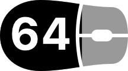
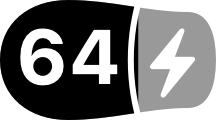

# mouse-battery

A small macOS menu bar app that shows the battery level of a Logitech wireless mouse.

 

The icon is a mouse seen from above. It fills up like the macOS battery icon and shows the
percentage. A bolt replaces the scroll wheel while the mouse is charging.

mouse-battery reads the battery level directly from the mouse. It does not need Logitech G HUB,
and it can run at the same time as G HUB.

## Requirements

- macOS 13 or later, on Apple Silicon or Intel
- A Logitech mouse that reports its battery over HID++ 2.0, connected through its USB receiver
  or a USB cable

Tested with the Logitech G Pro X Superlight and its Lightspeed receiver. Other Logitech
wireless mice that use the same protocol should work, but they are not tested.

## Install

1. Download `MouseBattery.zip` from the [latest release](../../releases/latest).
2. Double-click the zip file to unpack it.
3. Move `MouseBattery.app` to your Applications folder.
4. Open `MouseBattery.app`. macOS blocks it the first time. Follow the steps in the next section.

### First launch: "Apple could not verify MouseBattery"

The app is not signed with a paid Apple Developer ID, so macOS blocks it the first time you
open it. You only need to allow it once.

1. Double-click `MouseBattery.app`. macOS shows a warning that it could not verify the app.
   Click **Done**. Do not click **Move to Trash**.
2. Open **System Settings** and select **Privacy & Security**.
3. Scroll down to the **Security** section. It shows a message that MouseBattery was blocked.
   Click **Open Anyway**.
4. Confirm with Touch ID or your password, then click **Open Anyway** again.

The mouse icon then appears in the menu bar. After this, the app opens normally.

If you prefer Terminal, this command removes the block instead:

```bash
xattr -dr com.apple.quarantine /Applications/MouseBattery.app
```

## Use

Click the icon to open the menu.

| Menu item | What it does |
| --- | --- |
| Device name and battery status | Shows the level and whether the mouse is charging |
| Refresh Now | Reads the battery immediately |
| Launch at Login | Starts the app automatically when you log in |
| Quit | Closes the app |

The app reads the battery every 60 seconds, and also when the mouse reports a change or the
Mac wakes up. When the mouse is asleep or switched off, the icon is dimmed and shows the last
value that was read.

## Troubleshooting

Run the app in probe mode to see what the mouse answers:

```bash
/Applications/MouseBattery.app/Contents/MacOS/MouseBattery --probe
```

- `No Logitech device found`: check that the receiver or cable is plugged in.
- `Found a Logitech device, but the mouse did not answer`: move the mouse to wake it up, and
  check that it is switched on.

## Build from source

You need the Xcode Command Line Tools (`xcode-select --install`).

```bash
./build.sh
```

This creates `build/MouseBattery.app`. To also create the zip file for a release:

```bash
./build.sh --zip
```

After a change to the code, build again and restart the app:

```bash
./build.sh && pkill -x MouseBattery; open build/MouseBattery.app
```

### Change the icon

The icon is drawn in code in [Sources/BatteryIcon.swift](Sources/BatteryIcon.swift). The
values under `Tweakable appearance` at the top of the file set the weight and size of the
digits and the opacity of the empty part. To check the result without the menu bar, write
sample icons as PNG files:

```bash
build/MouseBattery.app/Contents/MacOS/MouseBattery --icon-preview ~/Desktop
```

## How it works

Logitech mice speak a protocol called HID++ 2.0 over a vendor-specific USB HID interface. The
app asks the mouse for its Unified Battery feature (`0x1004`), or the older Battery Status
feature (`0x1000`), and reads the charge level. It only sends read requests and never changes
a mouse setting.

## License

Released under the [MIT License](LICENSE).

## Disclaimer

This project is not affiliated with or endorsed by Logitech. Logitech, G HUB and Lightspeed
are trademarks of their owners.
